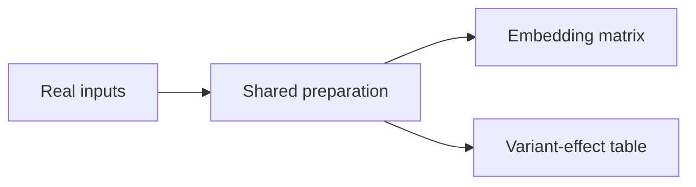

# Notebook2task through artifact reproduction

Local discussion draft — updated 2026-10-15. Scope clarified with the user: one task per
notebook, considering all branches and exporting eligible existing terminal
scientific results. Branches without eligible outputs are explicitly excluded
from the target inventory, while their original computation remains intact.
The intended source collection includes non-Python notebooks and documents.
Working representation agreed with the user: convert sources to plain scripts
in their original language. Factory workers inspect those scripts and execute
them with ordinary interpreters; the original documents provide context and
provenance.
Revised after independent review; the author response is recorded in the
[review note](artifact-reproduction-review-001.md#author-response--2026-10-14).
Other recommendations below remain proposals to iterate on. This document does
not implement or launch the proposed pipeline.

## 1. What we want to make simpler

Start from an existing notebook analysis and ask the solver to reproduce its
eligible terminal scientific results, considering all branches, given real inputs and complete
methodological instructions. Prefer the end products that people consume.
Use execution to establish reference outputs and test resource fit. The
factory's main reasoning problem becomes identifying those endpoints and
explaining the workflow needed to produce them.

The proposed unit of a task is:

**One notebook → one task: original inputs + unchanged source analysis + eligible
existing terminal-result artifacts + acceptance rules.**

GLM identifies the endpoints and specifies that task. Programmatic execution
supplies measured facts and reference artifacts; executable checks determine
acceptance. A successful converted reference run supplies execution evidence
for that workflow, not automatic evidence that its science is sound.

The intended competency is implementing a specified biological analysis. Novel
hypothesis formation and open-ended method selection would be separate task types.

Working choices carried from the pilot are GLM-5.3 for model-driven work, Harbor
task packaging, and offline solving/grading with internet available during
authoring/setup. These choices are separate from the proposed extraction method
and can be revisited explicitly.

## 2. What counts as a target?

Prefer an analysis's intended scientific endpoints. These often summarize a
large computation in a compact, interpretable artifact: a marker-gene table,
variant-effect scores, a set of candidate regions, or another result that people
consume. Compactness and a clear scientific schema can make storage, inspection
and comparison easier, while reducing dependence on a library's internal object
layout. These are useful tendencies, not eligibility rules: an embedding matrix
can itself be the intended end product.

In the user's Scanpy example, a marker-gene result can be the target even when
producing it requires preprocessing and normalizing a much larger matrix. The
solver may need the full upstream analysis without having to submit every
intermediate representation. This is an example of the selection principle,
not a factory rule requiring marker-gene tasks.

A scientific endpoint is not necessarily a literal leaf of the execution graph.
A marker table might feed a heatmap; the underlying table may be the preferable
target. Likewise, an unused variable or final diagnostic printout can be a graph
leaf without being an analysis objective. Source interpretation identifies the
intended result; execution establishes its provenance and reproducibility.
Several files can constitute one result, such as a matrix and its identifiers.

For this version, targets must already be stored in named variables or fields
of those objects in the original source. Preparation returns only code to save those values and their identifiers at
script completion; the controller appends it to the untouched baseline. Results
that are overwritten, deleted or out of scope by the end must be explicitly
excluded. Earlier capture/insertion support is deferred. It must not capture a previously unnamed expression
into a variable or reconstruct values computed only inside plotting functions.
For plots, export eligible existing terminal data only; do not introduce new
aggregation, filtering, ranking, scaling or other scientific computation to
recreate a figure. Explain plot-only results that have no eligible stored output.
Visual styling and image reproduction remain outside this version.

Intermediate results, diagnostic counts, preprocessing states and checkpoints
are not exported targets. Select scientific results from the source goals before
choosing storage. Exclude mixed analysis-state containers and select terminal
fields instead. Standalone result tables or embeddings may be exported whole;
preserve meaningful fields and identifiers and justify omissions. Plot display
or earlier computation does not automatically make a stored result intermediate.
Cover independent scientific outcomes in one task, not every tutorial section
or processing step. Classify results from the source narrative and interpretation:
preparatory statistics and diagnostics supporting other results are not extra
targets merely because they survive or are displayed. Apply selection within
annotation tables as well as within outer objects; preserve endpoint fields and
necessary identifiers/context. Explain independent outcomes lacking an eligible
stored result in the exclusions. Keep all original computation, including excluded
branches. Reject a source with no eligible terminal results.

For a notebook with two analysis branches, a single task would cover:

The task requires both the embedding matrix and the variant-effect table. It has
one instruction set and one input/environment package. Each solver attempt
covers both branches and receives one overall reward. Each branch has its own
artifact checks for diagnosis. Shared preparation can serve both branches within
the same attempt.

For v1, the solver starts from the **original inputs used by the source
notebook**. These may already be processed data if that is where the notebook
itself starts; we do not reconstruct upstream analyses outside the source.
Preserve filtering or subsampling already present in the source analysis, but
do not add input reductions or new starting checkpoints to make a candidate fit.
Those adaptations are deferred beyond v1. Every branch's required endpoint
must be produced by the solver, rather than supplied as an input answer.
The remaining task-design choices concern **how each endpoint is represented**.

Existing execution logs can support diagnosis. Adding intermediate exports is
outside this version. Reject a candidate if any original analysis branch fails
to execute, or any required eligible endpoint cannot be reproduced and graded
within the overall budget. Ineligible outputs are excluded by the selection rule,
not as a way to hide an execution or grading failure. The factory does not silently drop branches or split the notebook into
separate tasks. Related notebooks or task variants using the same data belong
in the same train/evaluation split.

Use scientific relevance to distinguish genuine endpoints from incidental
outputs. Use one endpoint inventory with source evidence and explicit exclusions
for branches without an eligible result. Prefer compact, portable representations
for those results. Small
output size is not a proxy for cheap computation or a reason to omit a branch.

Before freezing the task, a separate GLM review pass compares the proposed
inventory with the original document and converted scripts. It must look for
omitted eligible results, not just check that the inventory is internally consistent.
Record source references for included endpoints and reasons for excluding other
apparent scientific results. Freeze this reviewed inventory before the final
contract; changes to coverage require another review. Reuse the pipeline's
review role rather than adding a dependency-graph framework. This is a second
check for omissions, not proof that the inventory is complete.

## 3. Programmatic work versus GLM work

“Programmatic” describes reusable factory mechanisms. GLM may write a
notebook-specific setup recipe or exporter through a version-controlled prompt;
that code remains a generated artifact to execute and validate. Its claims do
not become measured facts merely because it is executable code.

| Responsibility | Programmatic work | GLM work |
| --- | --- | --- |
| Source intake | Pin notebook/data identities; inventory cells and files; record provenance and source terms. | Identify relevant data references, environment requirements and unresolved source assumptions. |
| Endpoint preparation | Validate response structure; append exports to untouched source, check combined syntax and compute the diff. | With no tools, select terminal results already held in original named variables or fields and return only end-of-script saving code. Explain exclusions and uncertainties in one inventory. |
| Script conversion | Check the source against a supported-feature profile before export; use a pinned deterministic exporter and verify code coverage/order after allowed transformations. | Reason over the scripts and source narrative to interpret unresolved assumptions and branch coverage. |
| Environment and input setup | Execute setup commands, preserve recipes/locks and input hashes, enforce the execution boundary. | With tools, inspect dependencies, diagnose installation failures, stage original inputs and adapt offline paths/caches. Preparation does none of this. |
| Reference execution | Run from a clean state under the intended limits; capture artifacts, hashes, elapsed time, errors and available resource diagnostics. | Distinguish setup failures from broken analysis code; propose bounded setup fixes and record reasons to reject a seed. |
| Task coverage and feasibility | Check the reviewed branch-to-artifact mapping, input availability and combined resource measurements. | Independently review endpoint completeness against the original source; explain endpoint representations, exclusions and feasibility blockers. |
| Instructions | Validate structure and link requirements to source/evidence. | Translate the executed analysis into a complete public specification, including consequential defaults and parameters. |
| Grading | Apply reusable comparators; run references, valid alternatives and wrong-output controls; calculate reward. | Propose scientifically meaningful equivalences, failure cases and any custom checks that templates cannot express. |
| Packaging and evaluation | Assemble Harbor files, enforce visibility boundaries, run blind attempts and preserve results. | Produce remaining task-specific text/code and repair permitted defects within the boundary and budgets below. |

The controller owns scheduling, limits, artifact identity and retry accounting.
The preparation worker has no tools: exactly one call, no automatic repair,
medium reasoning, strict JSON-schema responses and no extra client
token/byte caps. Execution setup can use tools to inspect and diagnose actual
failures; running the scientific script itself is programmatic. See the
[current workflow](reference-execution.md) for implemented boundaries and status.

Neither GLM nor the human operating the factory fills in unobserved shapes,
expected values or measured runtimes. Unsupported cases can be rejected. Human
changes improve reusable code/prompts; task-specific repairs still come from GLM
through the recorded pipeline.

## 4. Proposed flow

These are logical stages, not necessarily separate agents or one LLM call each.

1. **Convert, then prepare terminal-result exports.** Deterministically convert
   supported sources to plain scripts retaining narrative comments. GLM reads
   the script, provenance, conversion receipt and execution limits, without data
   contents or tools. It returns only export code, one endpoint inventory and brief
   exclusions/uncertainties. The controller appends that code after the unchanged
   script; selected results must still be accessible in their intended state. Programmatic checks
   preserve the response, check structure/syntax and compute the diff. A separate
   review checks eligibility and unchanged science against the original source.
2. **Establish a runnable script reference.** A tool-enabled execution worker
   owns dependency inspection/installation, original input downloads and offline
   path/cache setup. It records recipes, locks, hashes and adaptations, without
   changing scientific methods or inputs. Then run the reviewed script
   programmatically in a fresh process/workspace, offline and CPU-only, preserving
   the full original computation. Collect the declared terminal artifacts,
   runtime, failures and resource-fit evidence.
3. **Review coverage and specify the single task.** A separate GLM pass reviews
   completeness against the original source and scripts, then freezes the
   endpoint inventory. Specify the source's original inputs and representations
   of all required endpoints, then write instructions grounded in the execution.
   Retain all eligible endpoints, explicit exclusions and the source's computation.
   Measurements from reduced inputs or a different execution plan do not establish eligibility.
   The [current prompt and exact input bundle](specification-inputs/001/README.md)
   are prepared for review from setup run 001. This pass reviews the existing
   preparation inventory and writes a public brief plus private validation plan;
   it does not choose a new task scope. No specification model call has run yet.
4. **Construct and validate.** Wrap the runnable reference and exports as the
   private solution. Generate the public brief and grading contract. Execute
   controls and calibrate any numerical comparisons before freezing the task.
5. **Run a blind solver attempt.** Measure actual performance within the solver
   budget. Solver success is informative, not required to demonstrate a valid
   task. Stop or repair through the factory within explicit bounds. A repair
   invalidates affected validation evidence; rerun the relevant controls before
   treating the task as validated or attempting it again.

**Proposed seed admission rule:** if the notebook's analysis code is broken
after dependency and input setup has been addressed, reject it as a seed.
Start from the source's declared runtime, package versions and setup instructions;
allow bounded dependency installation, environment reconstruction and path
configuration. Faithful exports may expose existing results. Repairing analysis
logic, suppressing errors or skipping failed analysis branches to make a seed
qualify is outside this first version's scope. GLM diagnoses failures through
the recorded pipeline; clean execution supplies the evidence.

Freeze and hash the original source and the untouched deterministic conversion.
Keep every subsequent generated change as a diff with its purpose. The repair
worker and review step use the following boundary:

| Permitted repair | Outside the repair boundary |
| --- | --- |
| Reconstruct the declared environment; stage the declared inputs; configure paths. | Change scientific parameters, formulas, filtering rules, labels or methods to make execution succeed. |
| Export existing results faithfully, preserving values and identities. | Recompute a different result, skip a failed branch, suppress an analysis error or invent an expected answer. |
| Fix generated instructions, packaging or grader code to implement the frozen scientific contract. | Weaken the contract or tolerances because a reference, control or solver fails. |

Recorded diffs make these distinctions reviewable; a worker's claim that a
change is “setup” is insufficient. If it changes the scientific computation,
reject the seed under the v1 policy. Adding an input reduction or starting
checkpoint is outside v1, including as a response to resource exhaustion.
If explored later, it would be a separate design variant requiring data lineage,
full branch coverage and fresh reference/control runs. These rules apply to
GLM-generated changes and to the human operating the factory.

If the intended environment or inputs cannot be established within budget,
retain that reason separately from a diagnosed code defect. A script-conversion
failure also does not establish that the source analysis is broken. Preserve
rejected sources and failure records. This gate selects usable reference
analyses; it does not by itself establish scientific validity.

Inspect the source before executing an expensive or partially runnable notebook
within its authoring budget. The requirement is execution evidence for every
required endpoint **before finalizing the task contract**. Presentation-only
or diagnostic cells need not become task requirements. Failure to produce a
required eligible endpoint is a blocker for the whole candidate, not permission to
release only the successful branches.

For a first version, avoid building a general notebook dependency-graph engine.
Start with a source-backed execution plan and existing file outputs or explicit
exports for all eligible existing terminal results. Preserve source execution order where possible rather
than searching for minimal branch slices. The complete required workflow must
replay from declared inputs without hidden interactive state. Proposed branch
dependencies are supported only to the extent established by that execution.

An export should preserve each required result at the point where it exists,
including identifiers and representation. It should not recompute the analysis
with a different method. File hashes and schema checks help validate transport;
they do not by themselves establish semantic fidelity.

## 5. Test resource fit in Daytona with minimal instrumentation

Proposed first-version gate: run the complete reference analysis in a clean
Daytona sandbox under the intended task CPU, memory and disk limits, with an
explicit whole-run deadline. Require successful execution and validated fresh
artifacts for every required eligible endpoint. This can establish observed resource
fit without building a detailed profiler first.

Retain a small execution record:

| Evidence | What it establishes |
| --- | --- |
| Configured limits, environment and input identities, execution order and cache policy | The exact conditions tested. |
| Setup duration, execution start/end, timeout status and exit/error logs | Setup cost, reference runtime and evidence for diagnosing failures. |
| Complete endpoint manifest and artifact checks | The required analysis completed and produced usable outputs; absence of a crash alone is insufficient. |

The controller must wait for or terminate owned processes before calling a run
complete. A CPU limit can make work slow without causing a crash, so enforce a
wall-clock deadline. Treat code defects, resource exhaustion, unresolved setup
and infrastructure failures according to the evidence available. If the cause
is unknown, preserve that uncertainty. Resource exhaustion can disqualify a seed
for the task envelope without establishing a defect in the notebook's code.

Detailed per-cell CPU/memory profiling is optional diagnostic work. Daytona
documents current and historical CPU, memory and disk usage samples; preserve
those if readily available in the selected SDK/deployment. They need not become
a prerequisite for the first version, and sampled maxima are not guaranteed
process-tree peaks. A successful bounded run demonstrates fit on that run,
without quantifying spare memory or guaranteeing future runs will succeed.
[Daytona resource metrics](https://www.daytona.io/docs/en/python-sdk/sync/sandbox/#sandboxget_metrics)

Separate setup/download time, reference computation, verifier time and total
solver time. The agreed reference-computation limit is **600 seconds** for the
complete workflow, including all branches and artifact exports, after dependencies
and inputs are staged. This replaces the earlier proposed five-minute admission
gate. A source is not rejected merely because it leaves little headroom within
the current ten-minute solver allowance.

Choose total agent time separately: the solver needs time to understand the
instructions, write code, execute the computation and potentially correct or
rerun it. The current 600-second solver limit is provisional and may be extended
in a later decision. It is not evidence that a near-ten-minute reference is
feasible within that same total agent time. If an attempt uses the provisional
limit, record timeouts as such and do not interpret them as proof of an invalid
task or as an adequately budgeted test of solver capability. Measure reference
runtime first; do not infer a universal solver-time multiplier from one run.

The solver time and resource ceilings apply to the whole task, including all
branches. Each branch does not receive a separate solver allowance. Test the
actual combined workflow, including shared computation and cumulative disk use.

The current task envelope is a working constraint to carry forward for discussion:
4 vCPUs, 8 GiB RAM, 10 GiB disk, no GPU, and up to 600 seconds of reference
computation. Total solver model/tool time is a separate setting, currently
600 seconds and open to extension.
These are the selected task limits, not a newly verified claim about provider
maximums. Use the same CPU, memory and disk envelope for reference validation;
dependencies and inputs are staged before timing the offline computation.

Proposed finite budgets for the first experiment:

| Work | Limit and accounting |
| --- | --- |
| Environment build and input staging | 30 minutes cumulative across initial setup and retries. Record build/setup time separately from sandbox startup. |
| Reference or independently computed valid alternative | 600 seconds per complete execution, including imports, all branches and artifact exports. Environment construction and input downloads are separate. |
| Verifier | 120 seconds per invocation, separate from the solver clock. |
| Blind solver | Provisionally 600 seconds per attempt, with the total agent allowance to be revisited separately; at most two attempts, with a fresh attempt allowed after a permitted repair. The clock starts when the prepared sandbox and task are handed to the solver, before its first model request. It includes model latency and tool use; it excludes environment setup and final verification. |
| Preparation repairs | None automatically: one call, schema/syntax validation, preserve output or failure, then inspection. Scientific source repairs remain forbidden. Execution/construction budgets need reconciliation with the new stage separation before launch. |
| Model requests | Preparation permits exactly one GLM-5.3 call, medium reasoning, no extra client token/byte caps and the existing 600-second per-request timeout. Record execution-worker and downstream budgets before those stages launch. No automatic model escalation. |
| Whole experiment | Two hours of wall-clock work, including every stage and retry, followed by up to five minutes of active cleanup. Stop starting work when any applicable limit is exhausted; report and track unresolved cleanup rather than declaring it complete. |

All limits apply together. Exhausting a budget leaves a rejected, unresolved or
partially validated candidate, according to the evidence; it does not justify
relaxing the scientific contract. The reference deadline is an eligibility gate,
not a reason to change methods or inputs until the source fits. Reject a
candidate whose complete reference exceeds the computation or resource limits;
preserve the reason separately from a scientific code defect. These are proposal
defaults for a future run, not a report of execution or a change to the current
pipeline.

## 6. What does “reproduce” mean?

Proposed default: reproduce the specified computational result from the source
analysis, with documented tolerances and genuine equivalences. The reference
environment is pinned; the solver's software choice stays open when it satisfies
that public contract. The reference cannot impose hidden package-specific details.

An endpoint with a portable representation can still depend strongly on the
scientific method. For example, Scanpy's gene-ranking operation takes choices
about grouping, reference populations and statistical method. Those choices
belong in the instructions even when the submitted result is a small table.
[Scanpy gene-ranking API](https://scanpy.readthedocs.io/en/stable/generated/scanpy.tl.rank_genes_groups.html)

| Artifact property | Candidate comparison |
| --- | --- |
| Identifiers, required fields and mathematically exact integer quantities | Exact checks after only the explicitly allowed ordering/representation changes. |
| Floating-point results | Alignment by identity plus empirically justified numerical tolerances. |
| Membership or rankings derived from numerical results | Explicit cutoff and tie rules consistent with the permitted numerical variability; exact membership only when the contract justifies it. |
| Arbitrary labels or coordinate symmetries | Comparison invariant to the specific equivalence the contract permits. |
| Stochastic results | A validated comparison that accepts documented variation or equivalent representations while preserving the required scientific result and rejecting meaningful mistakes. |
| Plots | Grade eligible terminal data already held in original variables/fields. Exclude plot-only results that require reconstructing plotting internals or new scientific computation; explain exclusions. No image reproduction. |

The public contract states identifier alignment, duplicate and missing-value
handling, units, numerical precision/tolerances, threshold inclusion and tie
handling wherever relevant. Numerical tolerance alone does not define which
rows belong in a thresholded or top-ranked output. Resolve that interaction
before grading, including how admissible variation near a boundary is handled.

The agreed v1 rule for results that vary between valid runs is to accept
documented numerical tolerances or equivalent representations only when
executable controls establish that conforming results pass and meaningful
mistakes fail. Use fresh conforming runs to validate the allowed variation within
the existing budget. If a reliable comparison cannot be established for any
required endpoint, reject the whole notebook for v1. Record whether the reason
is a demonstrated grading failure or insufficient validation within budget;
neither establishes a scientific defect in the source.

Rerunning with a fixed seed alone is not a proof of cross-environment determinism.
If a tolerance also accepts meaningful wrong answers, do not widen it or weaken
the definition of correctness merely to retain the candidate. Permitted
equivalences must preserve the required scientific result.

Matching the final output does not prove every instructed method was followed.
Use meaningful wrong-method controls to test which distinctions the terminal
outputs support. Do not add intermediate exports in this version to claim that
every internal procedure was checked. If the required distinction cannot be
validated from the selected outputs, narrow the claim or reject the candidate;
do not claim verification of hidden procedures from outputs alone.

Before freezing the grader, execute these controls:

- The reference passes; an empty/no-op submission fails, and omitting any
  required endpoint fails.
- At least one consequential wrong-method or wrong-result control for each
  branch with a required endpoint fails. Choose it to test the claimed scientific distinction, not just
  file presence or formatting.
- Valid representation alternatives permitted by the contract pass. Wherever
  numerical or software portability is claimed, test an independently computed
  conforming alternative for that branch, computed from the public inputs and
  contract without reading reference artifacts. Reordering a copy of the
  reference establishes only order invariance, not implementation equivalence.

GLM proposes task-specific controls through version-controlled prompts;
execution establishes their results. Record the alternative's computation and
why it conforms to the public contract. If an independent alternative or a
discriminating wrong-method control cannot be validated within budget, do not
mark that claim validated. One alternative supplies evidence for the tested
case, not universal portability.

Freeze acceptance rules and tolerances before the blind solver attempt. A solver
failure does not justify easing them. LLM review can identify omissions; it does
not supply the reward. Binary reward remains the pilot starting point: all
required endpoint checks must pass for the single task to pass. Retain per-branch
and individual check results for diagnosis.

The public task supplies inputs, methodological instructions and output schemas.
The original solution code and expected outputs stay outside solver-visible
assets. Supplying the complete solved notebook would change the competency being
tested.

## 7. Convert to scripts, then execute

Plain scripts are the main working representation for factory agents and
execution. Convert source documents deterministically, then use ordinary
interpreters in Daytona. Python stays Python, R stays R, and other languages
retain their own runtimes. A source may produce several files and a recorded
entrypoint while remaining one task covering all its scientific branches.
Keep the original document for scientific context and provenance.

Workers inspect script files, use normal command-line tools and read ordinary
execution logs. Cell markers, notebook kernels and rendered reports are not
requirements. Exporter-added cell markers may remain as ordinary comments;
they have no role in execution, grading or the worker interface.

Use existing exporters with pinned versions and explicit options:

| Source | Candidate conversion | Execution |
| --- | --- | --- |
| Jupyter `.ipynb` | `nbconvert --to script`, or Jupytext script export | The source language's interpreter. |
| R-based knitr documents, including `.Rmd` and `.Rnw` | `knitr::purl()` to extract R code | `Rscript`. |
| Quarto `.qmd` | For supported single-language sources, `quarto convert` to `.ipynb`, followed by script export | The corresponding interpreter; engine-specific behavior needs checking. |
| Existing scripts | Preserve the source and its declared entrypoint | The declared interpreter. |

These are existing conversion capabilities, not claims of implemented support
in BioTasks. Quarto conversion uses `.ipynb` as an intermediate format before
script extraction. No LLM is needed to copy ordinary code into a script.
[nbconvert script export](https://nbconvert.readthedocs.io/en/latest/usage.html#executable-script),
[Jupytext CLI](https://jupytext.org/using/cli/),
[knitr extraction](https://pkg.yihui.org/rmarkdown-cookbook/purl),
[knitr formats](https://pkg.yihui.org/knitr/doc/knitr-refcard),
[Quarto conversion](https://quarto.org/docs/tools/vscode-notebook.html#converting-notebooks)

Preserve the original document, its narrative and metadata, the converted
scripts and converter settings. Keep a separate record of setup, path and
artifact-export additions. The original source provides context without making
a separate cell/chunk mapping an admission requirement.

Start with a narrow supported-feature profile for each format. Inspect the
original source **before export**, including execution-affecting metadata, so
content omitted by an exporter cannot disappear unnoticed:

| Source | Initial admission profile |
| --- | --- |
| Jupyter `.ipynb` | One declared language, code executed in document order, and only explicitly supported transformations. Unknown magics, foreign-language state exchange and reliance on interactive state are unsupported. Simple shell cells require a tested conversion rule. |
| R-based knitr documents | Ordinary R chunks, literal execution flags and supported presentation-only options. Respect `eval=FALSE`; retain computation hidden only from the rendered report. Executable content with `purl=FALSE`, inline computation, dynamic execution options, child documents, unresolved parameters and cross-engine state are unsupported until a reusable rule handles them. |
| Quarto `.qmd` | The same narrow single-language policy, with engine and execution metadata inspected before conversion to an intermediate `.ipynb`. Do not assume conversion preserves document execution settings. |
| Existing scripts | Preserve the declared runtime, entrypoint and computation. Ordinary subprocess calls already present in the source can remain; this does not require translating a mixed-language notebook. |

Use a small allowlist of deterministic transformations with explicit
preconditions. For example, move a simple early dependency-install command to
setup only if it does not change the environment midway through analysis. A
shell cell can become an ordinary shell invocation only when working directory,
state, ordering and failure behavior are preserved. A presentation directive
can be omitted only when it does not affect a required artifact. Unknown or
ambiguous cases are rejected as unsupported conversion; GLM does not invent a
one-off translation to rescue them. Each supported rule needs small converter
fixtures when implemented.

Check that every executable block admitted by the profile is accounted for in
the script, in order, after the recorded transformations. Preserve a compact
conversion record: exporter/version/options, detected execution features,
applied rules and coverage/order check results. This check can use the source
structure internally without adding cell markers or a cell/chunk map to the
worker interface. A successful export or script run alone does not establish
equivalent computation. A converter failure alone does not prove the source
analysis is broken.

Run the converted reference directly and check branch coverage and produced
artifacts. A native notebook run is not a prerequisite. Record the result as
converted-script execution. The text-only preparation worker selects and saves eligible terminal results.
A separate tool-enabled execution worker owns dependencies and input setup; both
use version-controlled prompts.

For dependency setup, reuse the source's declared image, lockfile or environment
recipe when available. Keep converter tooling in the factory environment where
possible; reference execution needs the source runtime and scientific/system
libraries. Use compatible prebuilt packages and cached dependency layers, adding
source-specific dependencies through a recorded recipe. A few reusable
environment families can avoid one oversized image containing every package.
Python's uv supports cached container dependency layers; versioned Rocker R
images offer compatible Linux CRAN binaries on supported platforms. Preserve
the versions the analysis requires rather than upgrading just to ease setup.
[uv container builds](https://docs.astral.sh/uv/guides/integration/docker/#intermediate-layers),
[Rocker R images](https://rocker-project.org/images/versioned/r-ver.html)

Record cold build/setup time separately from sandbox startup and reference
execution. Daytona snapshots can reuse prepared dependencies across validation
and solver attempts. Build the solver environment from the recorded recipe
with only dependencies and allowed inputs; keep source solutions, reference
outputs and answer-bearing caches outside it. Dependency caching can coexist
with fresh scientific computation.
[Daytona snapshots](https://www.daytona.io/docs/en/snapshots/)

Keep the execution wrapper small: invoke the recorded entrypoint in the prepared
environment, enforce whole-run limits, record elapsed time and exit/error logs,
and collect validated endpoint artifacts. Detailed profiling remains optional
as described above. Solvers also produce artifacts with their chosen software;
they need not execute or submit a notebook.

Native execution through nbclient, knitr or Quarto was considered for its
cell/chunk diagnostics and handling of document execution settings. We chose
script conversion to simplify execution and avoid mandatory notebook kernels
and report rendering. The size of any installation/runtime saving remains
unmeasured; conversion retains the scientific dependencies and computations.

The [factual profiler](../../src/biotasks/data_profile.py) covers bounded
file structure and identity. The prepared [Tasksmith integration](design_stage.py)
provides structured proposal machinery. The current preparation worker uses
strict JSON-schema responses and appended export code. Preparation makes one
call, validates structure/syntax and preserves failures without automatic repair.
The separate tool-enabled setup/offline-test worker is implemented with synthetic
boundary tests. Its first remote run passed the full offline reference in 147.5
seconds with all reviewed exports preserved; see [run 001](setup-runs/001/README.md)
for evidence and limits. The setup worker has no model-request-count cap; time
and spending bounds remain.
See [the current workflow](reference-execution.md) for the actual prompt, inputs,
outputs and limits. Harbor and the existing quality/release components remain
candidates downstream.

## 8. A small experiment that would test the idea

Use one notebook with its original inputs and produce one task covering its
eligible terminal results. Execute all original scientific branches and explain
any branches without eligible outputs. Reject it if the complete reference cannot fit the
resource and ten-minute computation limits; do not reduce inputs or introduce
a starting checkpoint to rescue it.
Convert it to plain scripts, then have GLM inventory and explain its endpoints
using the scripts and source narrative, with one source-backed endpoint inventory, explicit exclusions and a separate
completeness review. Do not hardcode an analysis
stage, genes, files or expected values into the factory.
Reuse the source computation as the reference instead of asking a builder to
invent an independent implementation of the whole analysis.

Check whether this produces a clear task, measured resource fit and a grader
that separates valid and invalid artifacts with less speculative authoring.
Record setup failures, extraction failures, grading failures, calls, elapsed time
and any required adaptations. Keep seed rejection distinct from solver failure.
One successful development case would establish feasibility, not generality;
later testing should freeze the rules before trying other notebook domains.

## 9. Working defaults and remaining choices

| Question | Working default | Trade-off |
| --- | --- | --- |
| How close must reproduction be? | Match the specified computation, allowing documented equivalences and software alternatives. | Easier to define than “same biological conclusion,” but may reject scientifically reasonable alternative analyses. |
| Where may a task start? | Use the original inputs used by the source notebook. Defer added reductions and new starting checkpoints beyond v1. | Keeps extraction simple and preserves the source workflow, but excludes analyses that need adaptation to fit. |
| Which endpoints are included? | Include eligible terminal results already held in original named variables or object fields; explain branches without eligible results. Keep all original computation. | Simpler exports, with explicit omissions where the source does not store a terminal result. No intermediate or full-state fallback. |
| What about endpoints presented as plots? | Save eligible existing results only; exclude plot-only results rather than reconstructing plotting internals. | Less custom code, but some displayed scientific results will not become graded targets. |
| What about results that vary between valid runs? | Accept documented tolerances or equivalent representations only after executable controls distinguish conforming results from meaningful mistakes. Reject the notebook for v1 if any required endpoint lacks a validated comparison. | Allows justified variation while excluding candidates whose grading remains unreliable or unvalidated within budget. |
| How much source adaptation is acceptable? | Preserve an untouched converted baseline; permit bounded environment/input setup, path configuration and faithful exports. Reject candidates requiring scientific changes, added reductions or new checkpoints. | Keeps the first version focused on runnable sources; unresolved setup failures remain distinct from code defects. |
| How automatic should grading be? | Reusable comparators first; GLM proposes semantic configuration and controls. Validate conforming alternatives and consequential mistakes before freezing the contract. | Unusual outputs may require custom generated checks or rejection. |
| How are computation and agent time limited? | Allow up to ten minutes for the complete reference computation. Choose total agent time separately; the current ten-minute solver allowance can be extended later. | Avoids rejecting runnable analyses solely to fit the current agent budget; near-limit computations need additional agent time for a useful capability assessment. |

Candidate-specific choices remain: which supported source to try, and the
endpoint schemas and comparison rules justified by that source. The factory's
workers should propose these from evidence through version-controlled prompts.
Record them before validation; a failed solver attempt does not silently change
them. Input reductions and new starting checkpoints are deferred beyond v1.
Broader format support and detailed profiling can also remain deferred.
